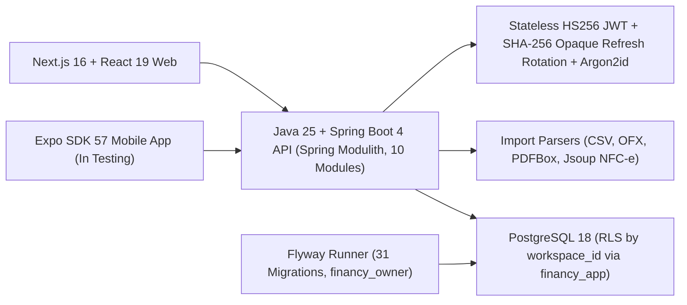

# Skorp Finance

[Português](#versao-em-portugues) | [English](#english-version)

> **Aviso de código privado:** Este repositório é a vitrine pública de arquitetura do Skorp Finance. O código-fonte é privado. Demonstração ao vivo sob pedido: [antonymsandrade@gmail.com](mailto:antonymsandrade@gmail.com) ou [LinkedIn](https://www.linkedin.com/in/antonyandrade01/).
>
> **Private repository notice:** This repository is the public architecture showcase for Skorp Finance. Source code is private. Live demos are available on request: [antonymsandrade@gmail.com](mailto:antonymsandrade@gmail.com) or [LinkedIn](https://www.linkedin.com/in/antonyandrade01/).

**No ar / Live:** [financeiro.antonyandrade.com.br](https://financeiro.antonyandrade.com.br) (app no ar; pede login / live app; requires login). Acesso de demonstração sob pedido / Demo access on request.

---

## Arquitetura / Architecture

---

## Versão em Português

### Problema que resolve

A primeira versão do sistema (feita em FastAPI) associava todas as transações a um único `user_id`, dificultando o controle financeiro compartilhado em família, e acumulava problemas estruturais na conciliação de extratos e na modelagem de contas.

O Skorp Finance nasceu para corrigir essas limitações com isolamento por espaço familiar (`workspace`), contas privadas ou compartilhadas, conciliação de extratos (CSV, OFX e PDF) e leitura de NFC-e. Também serviu como projeto prático para estudar Java 25 e Spring Boot 4: a escrita do código Java contou com apoio pesado de agentes de IA sob minha direção, enquanto eu conduzi a auditoria do sistema anterior em Python, o desenho dos módulos, as 31 migrations Flyway, as políticas de RLS e as regras de conciliação.

### Números reais

- Projeto pausado no momento; usado por mim e por mais um colega (outras pessoas testaram e não continuaram).
- Banco com histórico migrado de 23 usuários, 945 transações e 36 importações de extrato.
- Backend em Java 25 + Spring Boot 4 (4.1.1 no `pom.xml`) com Spring Modulith 2.1.1 organizado em 10 módulos (`identity`, `workspace`, `ledger`, `planning`, `investments`, `imports`, `receipts`, `insights`, `gamification`, `billing`).
- Soma 115 arquivos Java de produção, 32 arquivos de teste (JUnit 5 + Testcontainers com PostgreSQL real) e 31 migrations Flyway.

### Decisões técnicas e trade-offs

#### Monolito modular em vez de microsserviços

O backend roda como um único serviço Spring Boot 4 dividido por fronteiras verificadas em teste via Spring Modulith, enquanto banco, job de migração Flyway, API e frontend sobem como serviços separados no Coolify.

Trade-off: manter um único banco e uma única transação por lançamento financeiro evita problemas de consistência eventual em movimentações de dinheiro e reduz custo operacional. O risco de um erro em um módulo afetar a API inteira é mitigado por feature flags por plano e por espaço.

#### Isolamento por espaço (`workspace`) com RLS no PostgreSQL 18

Todo dado financeiro pertence a um `workspace_id`, ligado aos usuários pela tabela `membership` com papéis (`OWNER`, `ADMIN`, `MEMBER`, `VIEWER`) e suporte a contas privadas (`account.visibility = PRIVATE`). Toda requisição autenticada envia o header `X-Workspace-Id`, validado contra `membership`. No banco, a API conecta com o papel restrito `financy_app` (não dono das tabelas) e aplica Row-Level Security comparando `workspace_id` com `current_setting('app.workspace_id')`; Flyway e ETL rodam com `financy_owner`.

Trade-off: o mesmo modelo atende uso familiar e uma eventual abertura como SaaS sem refazer o schema, mas exige definir o contexto de workspace no início de toda transação e manter filtros manuais rigorosos nas tabelas globais (`app_user`, `membership`, `workspace`).

#### Autenticação com JWT stateless, rotação de refresh token e upgrade para Argon2id

A API usa JWT de acesso stateless (HS256 via Spring Security OAuth2 Resource Server) combinado com refresh token opaco salvo apenas como hash SHA-256 (`refresh_tokens`). Cada renovação gera um novo token na mesma família e revoga o anterior, com tolerância de 20 segundos (`REUSE_GRACE`) para cobrir respostas perdidas por recarregamento do navegador antes de disparar revogação da família inteira por suspeita de roubo. Senhas novas usam Argon2id; hashes bcrypt vindos do sistema anterior em Python são validados e atualizados automaticamente para Argon2id no login, com hash Argon2 fixo para equalizar o tempo de resposta quando o e-mail não existe.

Trade-off: controlar família de refresh tokens no PostgreSQL exige escrita em banco a cada renovação, mas permite revogar sessões comprometidas sem manter estado de sessão para cada requisição comum da API.

#### Estudo prático em Java com testes de integração reais

Como Java não é minha linguagem principal (estou estudando), exigi testes de integração com Testcontainers rodando contra PostgreSQL real e verificação de fronteiras do Spring Modulith para validar o código gerado e evitar regressões silenciosas nas 31 migrations Flyway e nos parsers de extrato (`PDFBox` 3.0.8 para PDF e `Jsoup` para NFC-e).

### Em produção vs. em teste

Em produção (pausado, uso restrito):
- API Java 25 / Spring Boot 4, banco PostgreSQL 18 com migrations Flyway e frontend web em Next.js 16 + React 19 publicados no Coolify via Cloudflare Tunnel, com backup diário.
- Cadastro de workspaces, contas, lançamentos, categorização, importação de extratos e migração conferida da base anterior.

Em teste / pausado:
- Aplicativo mobile em React Native (Expo SDK 57) com autenticação local e captura de comprovantes.
- Módulo de OCR para fotos de comprovante e abertura externa multiusuário.

---

## English Version

### Problem it solves

The first version of this personal finance tool (built in FastAPI) tied every transaction to a single `user_id`, blocking shared household budgets and accumulating reconciliation bugs across statement imports.

Skorp Finance rebuilds the domain around shared workspaces, private or shared accounts, bank statement reconciliation (CSV, OFX, PDF), and Brazilian receipt (NFC-e) parsing. It also acts as a hands-on study project for Java 25 and Spring Boot 4: AI coding agents wrote much of the Java code under my supervision, while I audited the legacy Python database, defined the modular layout, designed the 31 Flyway migrations, configured PostgreSQL RLS, and set the reconciliation rules.

### Real numbers

- Currently paused; used by me and one colleague (a few other testers tried it and stopped).
- Migrated dataset contains 23 users, 945 transactions, and 36 statement imports.
- Java 25 + Spring Boot 4 (4.1.1 in `pom.xml`) modular monolith built with Spring Modulith 2.1.1 across 10 modules (`identity`, `workspace`, `ledger`, `planning`, `investments`, `imports`, `receipts`, `insights`, `gamification`, `billing`).
- Contains 115 production Java files, 32 test files (JUnit 5 + Testcontainers against real PostgreSQL), and 31 Flyway migrations.

### Technical decisions and trade-offs

#### Modular monolith instead of microservices

The backend ships as a single Spring Boot 4 service with module boundaries enforced by Spring Modulith tests, while the database, Flyway migration job, API, and web frontend deploy as separate Coolify resources.

Trade-off: keeping one database and single-transaction writes avoids eventual consistency problems in financial balances and keeps operations simple. Module-level blast radius is contained through per-plan and per-workspace feature flags.

#### Workspace isolation with PostgreSQL 18 RLS

Every financial record belongs to a `workspace_id`, linked to users via `membership` roles (`OWNER`, `ADMIN`, `MEMBER`, `VIEWER`) plus optional private accounts (`account.visibility = PRIVATE`). Every authenticated request passes `X-Workspace-Id`, validated against `membership`. The API connects as a restricted database role (`financy_app`, non-owner) governed by RLS policies matching `current_setting('app.workspace_id')`, while Flyway and ETL jobs use `financy_owner`.

Trade-off: the schema handles both household sharing and multi-tenant plans without rework, at the cost of setting `app.workspace_id` on every transaction and guarding global auth tables (`app_user`, `membership`, `workspace`) explicitly in code.

#### Stateless JWT access, hashed refresh token rotation, and Argon2id upgrade

Authentication pairs stateless HS256 JWT access tokens (Spring Security OAuth2 Resource Server) with opaque refresh tokens stored only as SHA-256 hashes (`refresh_tokens`). Each refresh rotates the token within its family and allows a 20-second reuse grace window (`REUSE_GRACE`) for dropped browser responses before revoking the entire family on suspected theft. New passwords hash with Argon2id; legacy bcrypt hashes from the Python app verify and upgrade automatically to Argon2id on login, and a fixed dummy Argon2 hash equalizes response time for unknown emails.

Trade-off: refresh family tracking writes to PostgreSQL on token rotation, but lets the backend revoke compromised sessions without holding server-side state on regular API calls.

#### Practical Java study backed by real integration tests

Because I am actively learning Java rather than claiming production mastery, I required Testcontainers integration tests against real PostgreSQL and Spring Modulith boundary tests to verify the 31 Flyway migrations and statement parsers (`PDFBox` 3.0.8 for PDFs, `Jsoup` for NFC-e pages).

### Production vs. in testing

In production (paused, limited personal use):
- Java 25 / Spring Boot 4 API, PostgreSQL 18 with Flyway migrations, and Next.js 16 + React 19 web app deployed on Coolify behind Cloudflare Tunnel, with daily backups.
- Workspaces, accounts, ledger entries, categorization, statement imports, and verified legacy migration.

In testing / paused:
- React Native (Expo SDK 57) mobile app with local biometric auth and receipt capture.
- Receipt photo OCR container and public multi-user onboarding.
