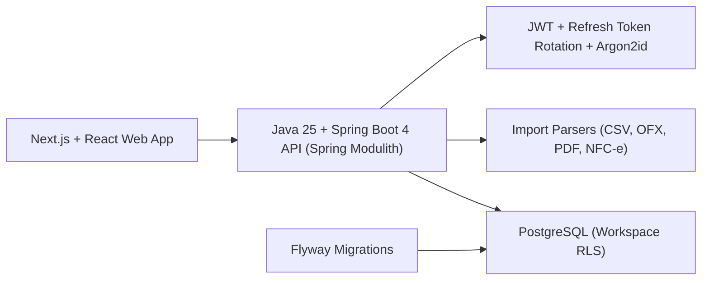

# Skorp Financy

[Português](#versao-em-portugues) | [English](#english-version)

> **Aviso de código privado:** Este repositório é a vitrine pública de arquitetura do Skorp Financy. O código-fonte é privado. Demonstração ao vivo sob pedido: [antonymsandrade@gmail.com](mailto:antonymsandrade@gmail.com) ou [LinkedIn](https://www.linkedin.com/in/antonyandrade01/).
>
> **Private repository notice:** This repository is the public architecture showcase for Skorp Financy. Source code is private. Live demos are available on request: [antonymsandrade@gmail.com](mailto:antonymsandrade@gmail.com) or [LinkedIn](https://www.linkedin.com/in/antonyandrade01/).

**No ar / Live:** [financeiro.antonyandrade.com.br](https://financeiro.antonyandrade.com.br) (app no ar; pede login / live app; requires login). Acesso de demonstração sob pedido / Demo access on request.

---

## Arquitetura / Architecture

---

## Versão em Português

### Problema que resolve

A primeira versão do sistema (em FastAPI) ligava todas as transações a uma única conta individual, o que travava o controle compartilhado em família e acumulava erros na conciliação de extratos.

O Skorp Financy reorganiza o sistema por espaços compartilhados (`workspace`), contas privadas ou da família, importação de extratos (CSV, OFX e PDF) e leitura de NFC-e. O projeto também serviu para estudar Java 25 e Spring Boot 4 na prática: agentes de IA escreveram boa parte do código Java sob minha direção, enquanto conduzi a auditoria da base anterior em Python, o desenho dos módulos, as migrations Flyway e as regras de RLS e conciliação.

### Decisões técnicas e trade-offs

#### Monolito modular em vez de microsserviços

Problema: dividir um sistema financeiro em vários serviços distribuídos dificulta manter consistência em saldos e aumenta o trabalho operacional.

O que foi feito: o backend roda como um único serviço Java 25 / Spring Boot 4 dividido por fronteiras verificadas em teste via Spring Modulith, enquanto banco, job de migrations, API e frontend sobem separados no Coolify.

Trade-off: manter um banco e uma transação por lançamento financeiro evita problemas de consistência eventual em movimentações de dinheiro. O risco de um erro em um módulo derrubar a API inteira é reduzido com feature flags por plano e por espaço.

#### Isolamento por espaço (`workspace`) com RLS no PostgreSQL

Todo dado financeiro pertence a um `workspace_id`, ligado às contas de acesso pela tabela `membership` com papéis e opção de conta privada. Toda requisição envia o cabeçalho `X-Workspace-Id`, validado contra o vínculo da conta. A API conecta com papel restrito no banco e aplica Row-Level Security pelo `workspace_id` ativo na sessão, enquanto migrations e ETL rodam com papel dono.

Trade-off: o mesmo modelo atende uso familiar e uma abertura futura para outras contas sem refazer o schema, mas exige definir o espaço ativo no início de toda transação e manter filtros explícitos nas tabelas globais de acesso.

#### Autenticação com JWT, rotação de refresh token e upgrade para Argon2id

A API combina JWT de acesso stateless com refresh token opaco salvo apenas como hash SHA-256. Cada renovação gera um novo token na mesma família e revoga o anterior, com tolerância de 20 segundos para cobrir respostas perdidas por recarregamento do navegador antes de revogar a família inteira por suspeita de roubo. Senhas novas usam Argon2id; hashes bcrypt da versão anterior em Python são validados e atualizados para Argon2id no login, com hash fixo para equalizar o tempo de resposta quando o e-mail não existe.

Trade-off: controlar a família de refresh tokens grava no PostgreSQL a cada renovação, mas permite revogar sessões comprometidas sem manter estado de sessão nas requisições comuns.

#### Estudo prático em Java com testes de integração reais

Como Java 25 e Spring Boot 4 estão em estudo e não são minha stack principal, exigi testes de integração com Testcontainers rodando contra PostgreSQL real e checagem de fronteiras do Spring Modulith para validar as migrations Flyway e os leitores de extrato (PDFBox para PDF e Jsoup para NFC-e).

### O que está no ar

- No ar como projeto de estudo em [financeiro.antonyandrade.com.br](https://financeiro.antonyandrade.com.br): API Java 25 / Spring Boot 4, PostgreSQL com Flyway e frontend web em Next.js + React no Coolify via Cloudflare Tunnel, com backup diário.
- Cadastro de workspaces, contas, lançamentos, categorias, importação de extratos (CSV, OFX, PDF e NFC-e) e migração conferida da base anterior em FastAPI.

---

## English Version

### Problem it solves

The first version of this personal finance tool (built in FastAPI) tied every transaction to a single individual account, blocking shared household budgets and accumulating reconciliation bugs across statement imports.

Skorp Financy rebuilds the domain around shared workspaces, private or shared accounts, bank statement import (CSV, OFX, PDF), and Brazilian receipt (NFC-e) parsing. It also served as a hands-on study project for Java 25 and Spring Boot 4: AI coding agents wrote much of the Java code under my supervision, while I audited the legacy Python database, defined the module layout, and designed the Flyway migrations, RLS rules, and reconciliation logic.

### Technical decisions and trade-offs

#### Modular monolith instead of microservices

Problem: splitting a finance backend into distributed services makes balance consistency harder and adds operational overhead.

What was done: the backend ships as a single Java 25 / Spring Boot 4 service with module boundaries enforced by Spring Modulith tests, while the database, migration job, API, and web frontend deploy as separate Coolify resources.

Trade-off: keeping one database and single-transaction writes avoids eventual consistency problems in balances. Module blast radius is contained with per-plan and per-workspace feature flags.

#### Workspace isolation with PostgreSQL RLS

Every financial record belongs to a `workspace_id`, linked to member accounts via `membership` roles plus optional private accounts. Every authenticated request passes `X-Workspace-Id`, validated against membership. The API connects as a restricted database role governed by RLS policies matching the active workspace, while migrations and ETL jobs use the owner role.

Trade-off: the schema supports both household sharing and multi-tenant plans without rework, at the cost of setting the workspace context on every transaction and guarding global auth tables explicitly in code.

#### Stateless JWT access, refresh token rotation, and Argon2id upgrade

Authentication pairs stateless JWT access tokens with opaque refresh tokens stored only as SHA-256 hashes. Each refresh rotates the token within its family and allows a 20-second reuse grace window for dropped browser responses before revoking the entire family on suspected theft. New passwords use Argon2id; legacy bcrypt hashes from the Python app verify and upgrade on login, with a fixed dummy Argon2 hash equalizing response time for unknown emails.

Trade-off: tracking refresh token families writes to PostgreSQL on each rotation, but lets the backend revoke compromised sessions without holding server-side session state on normal API calls.

#### Practical Java study backed by integration tests

Because Java 25 and Spring Boot 4 are languages I am studying rather than my primary stack, I required Testcontainers integration tests against real PostgreSQL and Spring Modulith boundary checks to verify the Flyway migrations and statement parsers (PDFBox for PDFs and Jsoup for NFC-e pages).

### What is live

- Live as a study project at [financeiro.antonyandrade.com.br](https://financeiro.antonyandrade.com.br): Java 25 / Spring Boot 4 API, PostgreSQL with Flyway migrations, and Next.js + React web app deployed on Coolify behind Cloudflare Tunnel, with daily backups.
- Workspaces, accounts, ledger entries, categorization, statement imports (CSV, OFX, PDF, NFC-e), and verified migration from the earlier FastAPI database.
